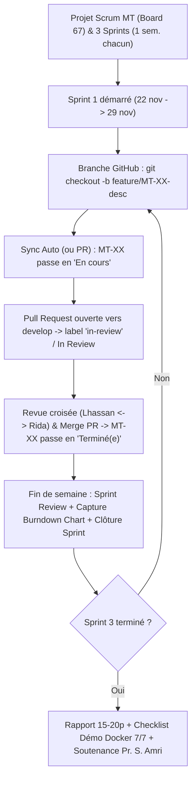

# Guide Complet SCRUM sous Jira — Projet 2 : MediTrack

> **Filière :** ILSI-4A — ENSAM Meknès (2026 / 2027)  
> **Encadrant :** Pr. S. Amri  
> **Équipe :** **Lhassan Oubihi** & **Rida Dandane** *(chacun gère des modules complets Backend + Frontend en parallèle)*  
> **Board Jira Scrum Live (Clé `MT`) :** https://lhassanoubihi.atlassian.net/jira/software/projects/MT/boards/67  
> **Dépôt GitHub :** https://github.com/lhassanoubihi/meditrack  
> **Durée totale :** **3 Semaines (3 Sprints × 7 jours)** — du **22 nov. au 13 déc. 2026**

---

## 1. Répartition Logique par Modules Complets (Back + Front tous les deux)

Plutôt que de travailler en série, Lhassan et Rida possèdent chacun des **modules complets de bout en bout (Node.js/MongoDB + Angular 17)** et avancent **100 % en parallèle** sur chaque sprint (**12 User Stories chacun**) :

| Membre | Rôle SCRUM | Modules Complets Assignés (Back + Front = 50/50) |
| :--- | :--- | :--- |
| **Lhassan Oubihi** | **Product Owner (PO)** + Dev Full-Stack | **12 User Stories (Back + Front)** : • *Sprint 1 :* Socle Docker/MEAN (`MT-8`) + **Module Auth 2FA / Users / RBAC complet** (`MT-10`, `MT-11`, `MT-12`) + UML/BPMN (`MT-13`) • *Sprint 2 :* **Module Rendez-vous, Notifications Email/SMS & Calendrier complet** (`MT-18`, `MT-19`, `MT-20`, `MT-21`) • *Sprint 3 :* **Module Statistiques & Dashboard Chart.js complet** (`MT-27`, `MT-28`) + Rapport/Démo (`MT-31`) |
| **Rida Dandane** | **Scrum Master (SM)** + Dev Full-Stack | **12 User Stories (Back + Front)** : • *Sprint 1 :* Socle Angular 17 (`MT-9`) + **Module Dossier Patient RGPD complet** (`MT-14`, `MT-15`, `MT-16`, `MT-17`) • *Sprint 2 :* **Modules Consultations, Ordonnances PDF & Pharmacie complets** (`MT-22`, `MT-23`, `MT-24`, `MT-25`, `MT-26`) • *Sprint 3 :* **Pôle Qualité complet : Tests Backend Jest ≥ 60% & Docker + Tests E2E Cypress** (`MT-29`, `MT-30`) + captures Jira (`MT-31`) |

> [!TIP]
> **Automatisation active sans ouvrir Antigravity IDE :** La tâche planifiée Windows **`MediTrack-GitHub-Jira-Sync`** exécute [`scripts/sync_github_jira.py`](../../scripts/sync_github_jira.py) toutes les 30 minutes. Dès que vous poussez une branche `feature/MT-XX-*`, ouvrez une PR ou mergez une PR sur GitHub, les statuts Jira avancent automatiquement (`À faire` → `En cours` → `In Review` → `Terminé(e)`) pour garder un **Burndown Chart** lisse et cohérent.

---

## 2. Ordre Jira & Automatisation (Étape par Étape)

### Plannings Quotidiens Prêts pour Antigravity
- [Calendrier global 21 jours](../planning/PLANNING_GLOBAL_21_JOURS.md)
- [Planning quotidien de Lhassan Oubihi](../planning/PLANNING_LHASSAN.md)
- [Planning quotidien de Rida Dandane](../planning/PLANNING_RIDA.md)

---

## 3. Planification Complète sur 3 Semaines (3 Sprints · 24 Stories · 122 pts)

### Sprint 1 — Semaine 1 (22 nov. → 29 nov. 2026) — Socles, Auth 2FA/RBAC & Dossier Patient RGPD
> **Statut :** **ACTIF** | **10 User Stories (5 Lhassan · 5 Rida Dandane)** — 51 pts

| Jira | GitHub | User Story | Couche | Pts | Assigné |
| :--- | :---: | :--- | :---: | :---: | :--- |
| **MT-8** | `#1` | US-01 : Architecture MEAN Stack, Docker Compose & MongoDB | Backend / DevOps | 5 | **Lhassan Oubihi** |
| **MT-9** | `#2` | US-02 : Initialisation Frontend Angular 17, Material & Layout | Frontend | 5 | **Rida Dandane** |
| **MT-10** | `#3` | US-03 : Authentification JWT, bcrypt & Double Auth 2FA | Backend | 5 | **Lhassan Oubihi** |
| **MT-11** | `#4` | US-04 : Gestion Utilisateurs & RBAC Multi-Rôles | Backend | 5 | **Lhassan Oubihi** |
| **MT-12** | `#5` | US-05 : Interfaces Angular Login, Inscription, 2FA & Profil | Frontend | 5 | **Lhassan Oubihi** |
| **MT-13** | `#6` | US-06 : Modélisation UML (Use Case, Classes) & BPMN Initiale | Conception | 3 | **Lhassan Oubihi** |
| **MT-14** | `#7` | US-07 : Modèle Mongoose Patient & Chiffrement RGPD AES-256 | Backend | 5 | **Rida Dandane** |
| **MT-15** | `#8` | US-08 : API REST CRUD Dossier Patient + Recherche & Tests Jest | Backend | 5 | **Rida Dandane** |
| **MT-16** | `#9` | US-09 : Interface Angular Liste, Recherche & Fiche Patient | Frontend | 8 | **Rida Dandane** |
| **MT-17** | `#10` | US-10 : Formulaires Angular Création & Édition Dossier Patient | Frontend | 5 | **Rida Dandane** |

---

### Sprint 2 — Semaine 2 (29 nov. → 06 déc. 2026) — Rendez-vous vs Consultations, PDF & Pharmacie
> **Statut :** Planifié | **9 User Stories (4 Lhassan · 5 Rida Dandane)** — 48 pts

| Jira | GitHub | User Story | Couche | Pts | Assigné |
| :--- | :---: | :--- | :---: | :---: | :--- |
| **MT-18** | `#11` | US-11 : API REST Rendez-vous & Détection Conflits Horaires | Backend | 5 | **Lhassan Oubihi** |
| **MT-19** | `#12` | US-12 : Service Notifications Email (Nodemailer) & SMS (Twilio) | Backend | 5 | **Lhassan Oubihi** |
| **MT-20** | `#13` | US-13 : Calendrier Interactif Angular & Prise de RDV en Ligne | Frontend | 8 | **Lhassan Oubihi** |
| **MT-21** | `#14` | US-14 : Gestion Statuts RDV (Confirmation, Report, Annulation) | Frontend | 5 | **Lhassan Oubihi** |
| **MT-22** | `#15` | US-15 : API REST Consultations (Compte-rendu & Diagnostic) | Backend | 5 | **Rida Dandane** |
| **MT-23** | `#16` | US-16 : Génération Ordonnance Numérique PDF & QR Code | Backend | 5 | **Rida Dandane** |
| **MT-24** | `#17` | US-17 : API REST Pharmacie (Validation Ordonnance & Stocks) | Backend | 5 | **Rida Dandane** |
| **MT-25** | `#18` | US-18 : Interface Médecin Consultation & Ordonnance PDF | Frontend | 5 | **Rida Dandane** |
| **MT-26** | `#19` | US-19 : Interface Pharmacien Validation Ordonnances & Stocks | Frontend | 5 | **Rida Dandane** |

---

### Sprint 3 — Semaine 3 (06 déc. → 13 déc. 2026) — Statistiques, Qualité Tests & Rapport
> **Statut :** Planifié | **5 User Stories (3 Lhassan · 2 Rida Dandane)** — 23 pts

| Jira | GitHub | User Story | Couche | Pts | Assigné |
| :--- | :---: | :--- | :---: | :---: | :--- |
| **MT-27** | `#20` | US-20 : API Statistiques & Agrégations MongoDB par Spécialité | Backend | 5 | **Lhassan Oubihi** |
| **MT-28** | `#21` | US-21 : Tableaux de Bord Analytiques Angular par Spécialité | Frontend | 5 | **Lhassan Oubihi** |
| **MT-29** | `#22` | US-22 : Couverture Tests Unitaires >= 60%, HTTPS & Docker Final | Backend / DevOps | 5 | **Rida Dandane** |
| **MT-30** | `#23` | US-23 : Tests E2E Cypress (Scénario Complet de Démonstration) | Frontend / QA | 5 | **Rida Dandane** |
| **MT-31** | `#24` | US-24 : Rapport Final 15–20 Pages, Burndown Charts Jira & Démo | Documentation | 3 | **Lhassan & Rida** |

---

## 4. Checklist Finale Obligatoire (Soutenance & Rapport — Pr. S. Amri)

- **Qualité du rapport (15–20 pages, UML/BPMN)** : **25 %**
- **Qualité du code (architecture, bonnes pratiques, tests ≥ 60 %)** : **25 %**
- **Gestion SCRUM sur Jira (Backlog, Sprints, Burndown, Vélocité)** : **20 %**
- **Démonstration machine (complétude, stabilité Docker)** : **20 %**
- **Présentation orale & réponses aux questions** : **10 %**

1. [ ] `docker-compose up --build` démarre sans erreur.
2. [ ] Interface Angular accessible sur `http://localhost:4200`.
3. [ ] Connexion multi-rôles + 2FA fonctionnelle.
4. [ ] Scénario complet : Patient → RDV → Consultation + PDF → Pharmacie → Dashboard Stats.
5. [ ] Persistance MongoDB vérifiée.
6. [ ] Board Jira présenté avec les **Burndown Charts** des 3 Sprints.
7. [ ] Couverture tests Jest `>= 60%` + Cypress E2E verts.
