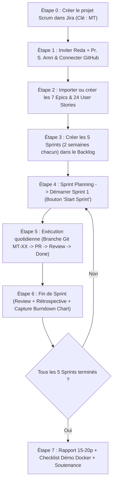

# Guide Complet SCRUM sous Jira — Projet 2 : MediTrack

> **Filière :** ILSI-4A — ENSAM Meknès (2026 / 2027)  
> **Encadrant :** Pr. S. Amri  
> **Équipe :** **Lhassan Oubihi** & **Reda**  
> **Dépôt GitHub :** `https://github.com/lhassanoubihi/meditrack`  
> **Fichier d'import Jira prêt à l'emploi :** [meditrack_jira_backlog.csv](./meditrack_jira_backlog.csv)

---

## 1. Répartition des Rôles SCRUM (Équipe de 2 : Lhassan & Reda)

Dans une équipe Scrum de 2 personnes, chaque membre porte un rôle Scrum officiel tout en contribuant à 50 % au développement technique (avec revues de code croisées via Pull Requests) :

| Membre | Rôle SCRUM | Responsabilités Scrum | Responsabilités Techniques (~50/50) |
| :--- | :--- | :--- | :--- |
| **Lhassan Oubihi** | **Product Owner (PO)** + Dev | • Crée et priorise le **Product Backlog** dans Jira<br>• Rédige les critères d'acceptation (DoD)<br>• Valide les User Stories lors de la **Sprint Review**<br>• Gère le dépôt GitHub & les merges vers `main` | **Lead Backend, Sécurité & DevOps**<br>• Node.js + Express + MongoDB (Mongoose)<br>• Authentification JWT, bcrypt, **2FA**, **RBAC**, chiffrement **RGPD AES-256**<br>• PDFKit (Ordonnances), Nodemailer/Twilio, Docker Compose, Tests Jest (>= 60%) |
| **Reda** | **Scrum Master (SM)** + Dev | • Crée et démarre les **Sprints** (2 semaines) dans Jira<br>• Anime les **Daily Stand-ups** (10 min) & **Rétrospectives**<br>• Suit le **Burndown Chart** et la **Vélocité** Jira<br>• Lève les blocages & documente les cérémonies pour le rapport | **Lead Frontend Angular 17 & QA**<br>• Angular 17 + TypeScript + RxJS + Angular Material<br>• Interfaces Auth/2FA, Dossiers Patients, Calendrier interactif RDV, Consultations, Pharmacie, Tableaux de bord<br>• Modélisation UML/BPMN & Tests **E2E Cypress** |

> [!TIP]
> **Pour maximiser les 20 % de note "Gestion SCRUM sur Jira"** : assurez-vous que **chacun déplace ses propres tickets** (`To Do` → `In Progress` → `In Review` → `Done`) au fil des jours du sprint — jamais tout d'un coup la veille de la soutenance, sinon le **Burndown Chart** sera plat puis en falaise !

---

## 2. L'Ordre Exact à Suivre dans Jira (Étape par Étape)

Suivez **strictement cet ordre** du Jour 0 jusqu'à la soutenance devant Pr. S. Amri :



### Étape 0 : Configuration initiale du Projet Jira (Jour 1 — Lhassan & Reda)
1. Allez sur **Jira Software** (Atlassian Cloud gratuit) → **Projects** → **Create Project**.
2. Choisissez le modèle **Scrum** (et type **Team-managed** ou **Company-managed**, idéalement **Company-managed** pour disposer de tous les rapports avancés : *Burndown Chart*, *Velocity Chart*, *Sprint Report*).
3. Nom du projet : **`MediTrack`** — Clé du projet : **`MT`** (vos tickets seront `MT-1`, `MT-2`, etc.).
4. Configurez les **4 colonnes** du Board Scrum :
   - **`TO DO`** (À faire)
   - **`IN PROGRESS`** (En cours)
   - **`IN REVIEW`** (Pull Request ouverte / Test croisé)
   - **`DONE`** (Mergé dans `develop`, testé, critères d'acceptation validés)

### Étape 1 : Invitations & Intégration Jira ↔ GitHub (Jour 1 — Lhassan)
1. **Paramètres du projet → Accès** :
   - Ajoutez **Reda** en tant qu'Administrateur / Membre.
   - *(Optionnel ou en fin de projet)* : préparez le partage ou l'export pour **Pr. S. Amri**.
2. **Connecter GitHub à Jira** (*Apps → GitHub for Jira*) :
   - Connectez le compte `lhassanoubihi` et sélectionnez le dépôt **`lhassanoubihi/meditrack`**.
   - Grâce à cela, dès que vous nommez une branche `feature/MT-3-auth-2fa` ou un commit `MT-3 feat(auth): add 2FA OTP`, le code et la PR apparaissent **automatiquement dans le ticket Jira** ! (Très apprécié par le jury.)
3. Sur GitHub (`Settings → Collaborators`), ajoutez le compte GitHub de **Reda** comme collaborateur sur `lhassanoubihi/meditrack`.

### Étape 2 : Remplir le Product Backlog (Epics + User Stories + Story Points)
Deux options :
- **Option rapide (Import CSV en 1 clic)** : Dans Jira → *Settings (engrenage) → System → External System Import → CSV* (ou *Issues → Import issues from CSV*), importez directement le fichier [meditrack_jira_backlog.csv](./meditrack_jira_backlog.csv).
- **Option manuelle (très propre sur Board)** : Créez d'abord les **7 Epics** dans le panneau *Epic* du Backlog, puis créez les **24 User Stories**, assignez à chaque Story son **Epic**, ses **Story Points** (suite de Fibonacci : `3, 5, 8`), sa **Priorité** (`High / Medium / Low`) et son **Assigné** (`Lhassan` ou `Reda`).

### Étape 3 : Organiser les 5 Sprints dans l'onglet Backlog
1. Cliquez 5 fois sur **Create Sprint** : `Sprint 1` à `Sprint 5`.
2. Glissez les User Stories dans chaque Sprint conformément au tableau ci-dessous.
3. **Ne démarrez que le Sprint 1** (durée : **2 semaines**, Objectif du Sprint rempli). Les Sprints 2 à 5 restent en attente dans le Backlog jusqu'à la clôture du sprint précédent.

### Étape 4 : Cycle quotidien pendant chaque Sprint (Règle d'or Scrum)
Pour **chaque User Story** (`MT-XX`) :
1. Déplacez le ticket de `TO DO` → `IN PROGRESS` sur le Board Jira.
2. Créez des **Sub-tasks** (sous-tâches techniques de 2h–4h) à l'intérieur de la Story pour montrer une granularité professionnelle.
3. Créez la branche Git depuis `develop` :
   ```bash
   git checkout develop && git pull origin develop
   git checkout -b feature/MT-XX-description-courte
   ```
4. Commitez régulièrement en incluant la clé Jira (`MT-XX`) :
   ```bash
   git commit -m "MT-XX feat(patients): add AES-256 encryption for medical history"
   ```
5. Poussez et ouvrez une **Pull Request** vers `develop` → déplacez le ticket Jira en `IN REVIEW`.
6. L'autre binôme (Reda review Lhassan, Lhassan review Reda) relit la PR, vérifie que la CI GitHub Actions passe, merge sur `develop` → déplacez le ticket en `DONE`.

### Étape 5 : Cérémonies de fin de Sprint (toutes les 2 semaines)
1. **Sprint Review (30 min)** : Démo fonctionnelle entre Lhassan (PO) et Reda (SM) sur `docker-compose up --build`. Validation de la *Definition of Done*. Merge `develop` → `main` avec un tag Git (`v0.1-sprint1`, `v0.2-sprint2`... `v1.0-final`).
2. **Capture Jira (OBLIGATOIRE pour le rapport)** : Allez dans *Reports → Burndown Chart* et *Velocity Chart*, prenez une capture d'écran propre et rangez-la dans `docs/rapport/`.
3. **Clôture du Sprint** dans Jira (*Complete Sprint*), puis **Sprint Retrospective (20 min)** documentée (Ce qui a bien marché / À améliorer / Actions pour le Sprint suivant).
4. **Sprint Planning** du Sprint suivant → *Start Sprint*.

---

## 3. Product Backlog Complet (7 Epics · 24 User Stories · 122 Story Points)

### Vue d'ensemble des 7 Epics
| Code | Nom de l'Epic | Sprint(s) | Priorité | Points |
| :--- | :--- | :---: | :---: | :---: |
| **EPIC-1** | Architecture, Sécurité & Authentification 2FA | Sprint 1 | Haute | 28 |
| **EPIC-2** | Gestion des Dossiers Médicaux Patients | Sprint 2 | Haute | 23 |
| **EPIC-3** | Prise de Rendez-vous & Notifications | Sprint 3 | Haute | 23 |
| **EPIC-4** | Consultations & Ordonnances Numériques PDF | Sprint 4 | Moyenne | 15 |
| **EPIC-5** | Module Pharmacie & Stock Médicaments | Sprint 4 | Moyenne | 10 |
| **EPIC-6** | Statistiques & Tableaux de Bord | Sprint 5 | Basse | 10 |
| **EPIC-7** | Qualité, Tests E2E, Déploiement & Documentation | Sprint 5 | Basse | 13 |
| | **TOTAL** | **5 Sprints (10 sem.)** | | **122 pts** |

*(Équilibre global : **Lhassan ~61.5 pts** · **Reda ~60.5 pts**)*

---

### Sprint 1 (Semaines 1–2) — Architecture MEAN, Auth 2FA, Rôles & Modélisation
> **Objectif du Sprint :** Disposer d'une stack MEAN conteneurisée sous Docker avec authentification sécurisée JWT + 2FA, contrôle d'accès par rôle (RBAC) et diagrammes UML/BPMN validés.  
> **Charge :** 28 Story Points (Lhassan : 15 pts · Reda : 13 pts)

| ID | User Story | Epic | Pts | Priorité | Assigné | Critères d'Acceptation (DoD) |
| :--- | :--- | :---: | :---: | :---: | :---: | :--- |
| **US-01** | Architecture MEAN Stack, Docker Compose & MongoDB | EPIC-1 | 5 | Haute | **Lhassan** | `docker-compose up --build` lance MongoDB + Backend + Frontend ; `GET /api/health` retourne 200. |
| **US-02** | Initialisation Angular 17, Angular Material, Routing & Layout | EPIC-1 | 5 | Haute | **Reda** | App Angular 17 compilée, thème Material médical, Sidebar dynamique par rôle, HTTP Interceptor JWT prêt. |
| **US-03** | Authentification JWT, bcrypt & Double Authentification (2FA) | EPIC-1 | 5 | Haute | **Lhassan** | Endpoints `/api/auth/register`, `/login`, `/verify-2fa` ; mots de passe hachés bcrypt ; OTP valide 5 min. |
| **US-04** | Gestion Utilisateurs & RBAC (Admin, Médecin, Infirmier, Pharmacien, Patient) | EPIC-1 | 5 | Haute | **Lhassan** | Middlewares `authenticate` et `authorize(roles)` fonctionnels ; accès interdit renvoie HTTP 403 ; CRUD Admin. |
| **US-05** | Interfaces Angular Login, Inscription, Vérification 2FA & Profil | EPIC-1 | 5 | Haute | **Reda** | Formulaires réactifs validés, écran saisie code 2FA, `AuthGuard` + `RoleGuard`, redirection par rôle. |
| **US-06** | Modélisation UML (Use Case, Classes) & BPMN initiale | EPIC-1 | 3 | Haute | **Reda** *(+Lhassan)* | Diagrammes exportés dans `docs/uml/` et `docs/bpmn/` validant les entités et flux métier. |

**Sous-tâches recommandées (Sub-tasks Jira) :**
- `US-03` : Schéma Mongoose `User` → Service hachage `bcrypt` → Génération JWT → Envoi/vérification code OTP 2FA → Tests Jest.
- `US-05` : Composant `LoginComponent` → Composant `TwoFactorComponent` → Service `AuthService` (RxJS) → Guards de routes.

---

### Sprint 2 (Semaines 3–4) — Module Dossier Patient (CRUD, RGPD) & UI Angular
> **Objectif du Sprint :** Permettre aux médecins et infirmiers de créer, rechercher, consulter et mettre à jour des dossiers patients dont les données sensibles sont chiffrées (RGPD).  
> **Charge :** 23 Story Points (Lhassan : 10 pts · Reda : 13 pts)

| ID | User Story | Epic | Pts | Priorité | Assigné | Critères d'Acceptation (DoD) |
| :--- | :--- | :---: | :---: | :---: | :---: | :--- |
| **US-07** | Modèle Mongoose Patient & Chiffrement RGPD (AES-256) | EPIC-2 | 5 | Haute | **Lhassan** | Schéma `Patient` (identité, groupe sanguin, antécédents, allergies, traitements) ; champs sensibles chiffrés en BDD. |
| **US-08** | API REST CRUD Dossier Patient + Recherche & Tests Jest | EPIC-2 | 5 | Haute | **Lhassan** | `POST/GET/PUT/DELETE /api/patients` protégé (`authorize('medecin','infirmier')`), recherche & pagination, tests Jest verts. |
| **US-09** | Interface Angular Liste, Recherche, Filtrage & Fiche Patient | EPIC-2 | 8 | Haute | **Reda** | `MatTable` avec recherche instantanée (nom/CIN) + pagination ; fiche détaillée avec onglets (Antécédents, Allergies, Traitements). |
| **US-10** | Formulaires Angular Création/Édition Dossier Patient | EPIC-2 | 5 | Haute | **Reda** | Reactive Forms avec `FormArray` dynamique pour ajouter/supprimer allergies et traitements ; snackbar Material de confirmation. |

---

### Sprint 3 (Semaines 5–6) — Module Rendez-vous, Calendrier Interactif & Notifications
> **Objectif du Sprint :** Permettre la prise de rendez-vous en ligne sans conflit horaire, visualisée sur un calendrier interactif, avec notifications Email & SMS.  
> **Charge :** 23 Story Points (Lhassan : 10 pts · Reda : 13 pts)

| ID | User Story | Epic | Pts | Priorité | Assigné | Critères d'Acceptation (DoD) |
| :--- | :--- | :---: | :---: | :---: | :---: | :--- |
| **US-11** | API REST Rendez-vous & Détection des Conflits Horaires | EPIC-3 | 5 | Haute | **Lhassan** | CRUD `/api/appointments`, détection chevauchement pour un médecin (HTTP 409 Conflict), filtres par médecin/date/statut. |
| **US-12** | Service Notifications Email (Nodemailer) & SMS (Twilio) | EPIC-3 | 5 | Haute | **Lhassan** | Envoi email automatique (SMTP/Mailtrap) à la création/confirmation ; SMS Twilio avec mode sandbox configurable via `.env`. |
| **US-13** | Calendrier Interactif Angular & Prise de RDV en Ligne | EPIC-3 | 8 | Haute | **Reda** | Sélection spécialité → médecin → créneau libre uniquement sur calendrier (vues jour/semaine/mois) ; réservation en 3 clics. |
| **US-14** | Workflow Confirmation, Report & Annulation de RDV | EPIC-3 | 5 | Haute | **Reda** | Espace Médecin & Patient pour changer le statut (`PENDING` → `CONFIRMED` / `CANCELLED` / `COMPLETED`) avec notification associée. |

---

### Sprint 4 (Semaines 7–8) — Consultations, Ordonnances PDF & Module Pharmacie
> **Objectif du Sprint :** Digitaliser le cycle clinique complet : consultation médicale → génération d'ordonnance PDF → validation en pharmacie et mise à jour du stock médicaments.  
> **Charge :** 25 Story Points (Lhassan : 15 pts · Reda : 10 pts)

| ID | User Story | Epic | Pts | Priorité | Assigné | Critères d'Acceptation (DoD) |
| :--- | :--- | :---: | :---: | :---: | :---: | :--- |
| **US-15** | API REST Consultations (Compte-rendu, Constantes, Diagnostic) | EPIC-4 | 5 | Moyenne | **Lhassan** | CRUD `/api/consultations` relié au `Patient` et à l'`Appointment` ; historique chronologique consultable. |
| **US-16** | Génération d'Ordonnance Numérique PDF (PDFKit + QR Code) | EPIC-4 | 5 | Moyenne | **Lhassan** | `GET /api/prescriptions/:id/pdf` génère un PDF structuré (en-tête MediTrack, médecin, patient, posologie, QR de vérification). |
| **US-17** | API REST Pharmacie (Validation Ordonnance & Stock Médicaments) | EPIC-5 | 5 | Moyenne | **Lhassan** | CRUD `/api/medications` + `PATCH /api/prescriptions/:id/dispense` décrémentant le stock, empêchant la double délivrance et signalant les ruptures. |
| **US-18** | Interface Médecin Saisie Consultation & Ordonnance PDF | EPIC-4 | 5 | Moyenne | **Reda** | Formulaire consultation + ajout dynamique de médicaments/posologies + bouton **Télécharger Ordonnance PDF**. |
| **US-19** | Interface Pharmacien Validation Ordonnances & Stocks | EPIC-5 | 5 | Moyenne | **Reda** | Liste des ordonnances à délivrer, bouton Valider, écran CRUD médicaments avec badge rouge si `stock <= seuilMin`. |

---

### Sprint 5 (Semaines 9–10) — Statistiques, Tests E2E Cypress, Déploiement & Rapport
> **Objectif du Sprint :** Finaliser les tableaux de bord analytiques, atteindre ≥ 60 % de couverture de tests, exécuter les tests E2E Cypress, livrer le rapport (15–20 pages) et valider la démo machine.  
> **Charge :** 23 Story Points (Lhassan : 11.5 pts · Reda : 11.5 pts)

| ID | User Story | Epic | Pts | Priorité | Assigné | Critères d'Acceptation (DoD) |
| :--- | :--- | :---: | :---: | :---: | :---: | :--- |
| **US-20** | API Statistiques & Agrégations MongoDB par Spécialité | EPIC-6 | 5 | Basse | **Lhassan** | `GET /api/stats/dashboard` via Aggregation Pipeline (patients, RDV/mois, consultations/spécialité, alertes stock). |
| **US-21** | Tableaux de Bord Analytiques Angular (Chart.js) | EPIC-6 | 5 | Basse | **Reda** | KPI cards + graphiques interactifs (barres, courbes, doughnut par spécialité) dynamiques selon la période. |
| **US-22** | Tests Unitaires Backend (>= 60%), HTTPS & Optimisation Docker | EPIC-7 | 5 | Basse | **Lhassan** | `npm test` affiche `>= 60%` de couverture ; `docker-compose up --build` démarre sans erreur avec persistance volume MongoDB. |
| **US-23** | Tests E2E Cypress (Scénario de Démonstration Complet) | EPIC-7 | 5 | Basse | **Reda** | Scénario E2E automatisé (Login → Patient → RDV → Consultation + PDF → Dashboard) 100 % vert. |
| **US-24** | Rapport Final (15–20p), Burndown Charts Jira & Répétition Démo | EPIC-7 | 3 | Basse | **Lhassan & Reda** | Rapport conforme à la structure Pr. S. Amri + `docker-compose.yml` en annexe + démo testée de bout en bout. |

---

## 4. Checklist Finale Obligatoire (Soutenance & Rapport — Pr. S. Amri)

### Barème d'évaluation à garder en tête
- **Qualité du rapport (15–20 pages, UML/BPMN)** : **25 %**
- **Qualité du code (architecture, bonnes pratiques, tests ≥ 60 %)** : **25 %**
- **Gestion SCRUM sur Jira (Backlog, Sprints, Burndown, Vélocité)** : **20 %**
- **Démonstration machine (complétude, stabilité Docker)** : **20 %**
- **Présentation orale & réponses aux questions** : **10 %**

### Les 7 points de la Checklist Démonstration Machine
1. [ ] `docker-compose up --build` démarre sans aucune erreur.
2. [ ] Interface web Angular accessible sur `http://localhost:4200`.
3. [ ] Connexion multi-rôles démontrée (Admin, Médecin, Pharmacien, Patient) avec 2FA.
4. [ ] Scénario métier complet sans bug bloquant : *Création Dossier Patient → Prise de RDV → Consultation + Ordonnance PDF → Validation Pharmacie → Tableau de bord Statistiques*.
5. [ ] Persistance MongoDB vérifiée (redémarrage conteneur sans perte de données).
6. [ ] Board Jira présenté en direct (Backlog, Epics, Sprints 1–5, **Burndown Charts**, **Velocity Chart**).
7. [ ] Résultats des tests unitaires (`npm test`) affichant **couverture ≥ 60 %** + exécution **Cypress E2E**.
